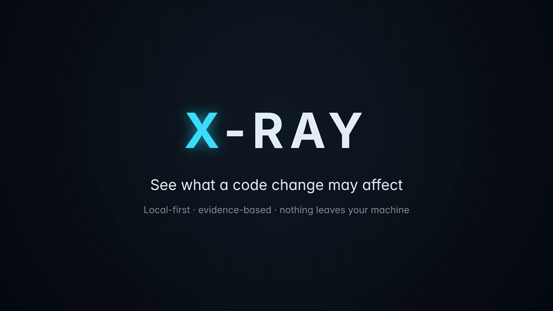
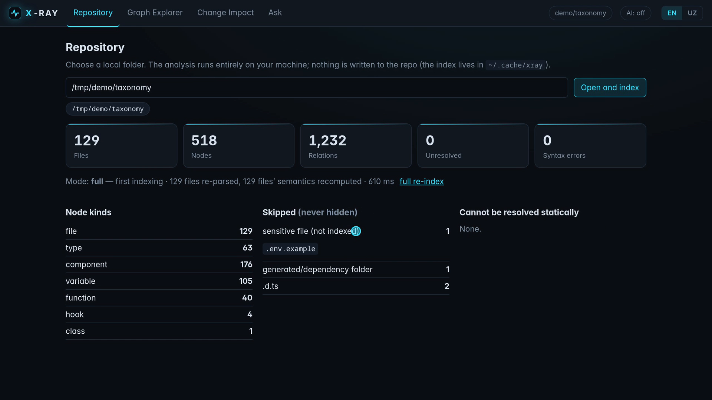
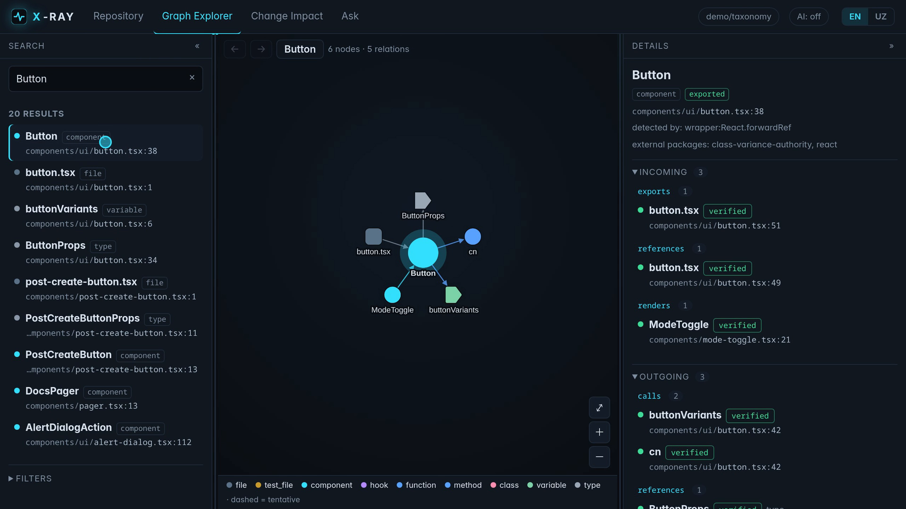
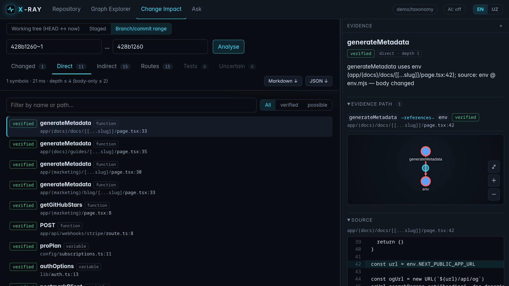
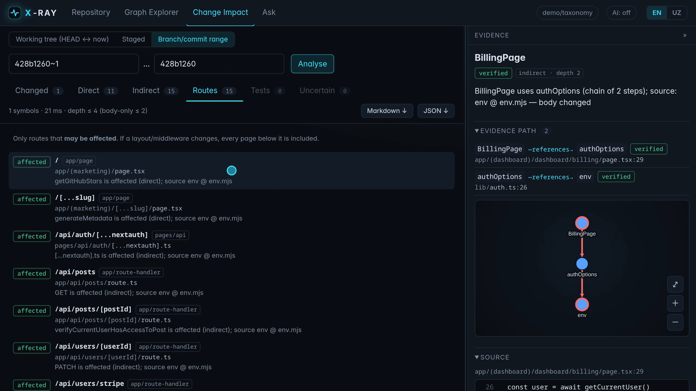

# X-Ray

> 🇬🇧 [English README](README.md)

> **Local-first code intelligence for TypeScript/React.** Open a repo, get its real code graph, and see — *with evidence* — what a Git change may affect, which tests are related, and what the analysis could not see.

X-Ray oddiy "kod xaritasi" yoki yana bir chatbot emas. Uning markazida **Change Impact**: Git diff'dan boshlab, *nima o'zgardi → nima ta'sirlanishi mumkin → nimani tekshirish kerak* degan savollarga **dalil yo'li bilan** javob beradi va hech qachon "buziladi" demaydi.



*Demo: ochiq `taxonomy` (Next.js) reposida bitta commit — `env.mjs` o'zgardi. Ovozli preview: [docs/demo.mp4](docs/demo.mp4). YouTube/Reels formatlari: [video/README.md](video/README.md).*

| Repozitoriy | Graph Explorer | Change Impact | Savol (AI ixtiyoriy) |
|---|---|---|---|
|  |  |  |  |

**UI:** yon panellar sichqoncha (sudrash), klaviatura (← →, Home = asl o'lcham, Enter = yig'ish) bilan o'lchami o'zgaradi va saqlanadi; markaz 340 px dan torayib ketmaydi; tor ekranda panellar yo'qolmaydi, drawer bo'ladi.

## Tamoyillar

- **Change-first** — boshlanish nuqtasi grafik emas, diff.
- **Evidence-first** — har bir natija `fayl:satr` + zanjir + ishonch darajasi bilan.
- **Local-first** — tahlil va indeks sizning kompyuteringizda; repoga hech narsa yozilmaydi; repodagi kod **hech qachon bajarilmaydi**.
- **O'lchanadigan** — aniqlik mustaqil oracle bilan o'lchangan ([docs/BENCHMARKS.md](docs/uz/BENCHMARKS.md)), cheklovlar yashirilmagan ([docs/KNOWN_LIMITS.md](docs/uz/KNOWN_LIMITS.md)).

## Next.js

Sahifalar, layout'lar, route handler'lar va middleware'ni import qiluvchi yo'q — framework chaqiradi. X-Ray fayl yo'lidan **marshrutni** aniqlaydi (App Router: `(group)`/`@slot` URL'dan chiqariladi; Pages Router; `middleware`/`proxy`; monorepo) va Impact hisobotida **"qaysi marshrutlar ta'sirlanishi mumkin"** ro'yxatini beradi: layout/middleware o'zgarsa, uning ostidagi hamma sahifa kiradi. Faqat Next.js loyihasida (`next` dependency yoki `next.config.*`) qo'llanadi.

## MCP va testlar buyrug'i

- `xray mcp` — AI agentlar (Claude Code, Cursor…) uchun stdio MCP server (faqat o'qish): `xray_impact`, `xray_search`, `xray_node`, `xray_index`. Sozlash: [docs/MCP.md](docs/MCP.md) (inglizcha).
- Impact hisobotida ta'sirlangan testlar uchun **tayyor buyruq** (Vitest/Jest `package.json`dan aniqlanadi) — UI'da nusxa olish tugmasi bilan.

## Tillar (uz / en)

UI, hisobot (sabablar, xabarlar, Markdown), xatolar, AI rozilik matni va CLI **ikki tilli**. UI: sarlavhadagi **EN/UZ** tugmasi (brauzer tilidan aniqlanadi, tanlov saqlanadi). CLI: `--lang en` yoki `XRAY_LANG=en`. Standart til hozircha `uz` (`packages/core/src/i18n.ts`dagi `DEFAULT_LANG`; testlar shunga tayanadi).

## Ishonch modeli

| Daraja | Ma'nosi |
|---|---|
| `verified` | Statik tahlil (TypeScript type-checker) bilan isbotlangan bog'lanish |
| `possible` | Kamida bir bo'g'in taxminiy (obyekt a'zosi orqali, fayl darajasidagi o'zgarish...) |
| `unresolved` | Statik hal qilib bo'lmaydi (`import(expr)`, `obj[key]()`, hal bo'lmagan alias…) — **yashirilmaydi**, alohida ko'rsatiladi |

`verified` — *bog'lanish* haqida, xato bo'lishi haqida emas. Hisobot "ta'sirlanishi mumkin" deydi, "buziladi" demaydi.

## Tez boshlash

Talablar: Node (sinalgan: **v26.11**; type-stripping va `node:sqlite` sababli ≥ 24 kutiladi, lekin sinalmagan), pnpm, git, tar. Faqat Linux'da sinalgan.

```bash
pnpm install
pnpm demo                         # takrorlanadigan demo: fixture repo + imzo o'zgarishi + hisobot
pnpm xray index  <papka>/repo   # indekslash (incremental, kesh ~/.cache/xray)
pnpm xray impact <papka>/repo               # ishchi katalog vs HEAD
pnpm xray impact <papka>/repo --base main --head feature --md
pnpm xray search <papka>/repo useArticle
pnpm serve                        # lokal web UI (URL + token terminalda chiqadi)
```

AI **default o'chiq**. Yoqish: `pnpm xray ai enable --provider anthropic` (rozilik matni ko'rsatiladi; API kalit faqat env'dan o'qiladi, faylga yozilmaydi). Rozilik bo'lmasa tarmoq chaqiruvi kodi umuman yetib bormaydi — testlar bilan isbotlangan.

## Arxitektura (modulli monolit)

```
 scanner ─► parser ─► graph (TS Program + checker, SQLite, incremental) ─► impact ◄─ git
                         │                                                  │
                         └──► retrieval (symbol + FTS5 + graph) ─► ai ──────┤
                                                                            ▼
                                        server (127.0.0.1, token) ─► web UI · CLI
```

`core` (tiplar) ← `scanner`, `parser`, `git` ← `graph` ← `impact`, `retrieval` ← `ai` ← `server` ← `cli`/`web`. Tahlil paketlari React/DOM/HTTP'ga bog'liq emas. Batafsil: [docs/ARCHITECTURE.md](docs/uz/ARCHITECTURE.md), qarorlar va sabablari: [docs/TECHNICAL_DECISIONS.md](docs/uz/TECHNICAL_DECISIONS.md).

## Natijalar (haqiqiy o'lchovlar, 2026-10-28)

Mustaqil oracle = TypeScript LanguageService `findReferences`. Fayl darajasida, eksport qilingan symbol'lar, **7 ta real loyiha (3414 symbol)**: 4 tasi muallifniki, 3 tasi ochiq Next.js (taxonomy, commerce, platforms):

| Loyiha | Symbol | `verified` precision | `verified` recall | Barcha edge'lar precision |
|---|---:|---:|---:|---:|
| private project A (1267 fayl) | 1770 | 1.000 | 1.000 | 0.992 |
| private project B | 860 | 1.000 | 1.000 | 0.999 |
| private project C | 301 | 1.000 | 1.000 | 1.000 |
| private project D | 52 | 1.000 | 1.000 | 1.000 |
| *ochiq:* taxonomy / commerce / platforms | 271 / 109 / 51 | 1.000 | 1.000 | 1.000 |

⚠️ Oracle ham TypeScript checker'idan foydalanadi — bu **ekstraksiya to'liqligini** o'lchaydi, dinamik/framework bog'lanishlarni emas. Qolgan cheklovlar [KNOWN_LIMITS](docs/uz/KNOWN_LIMITS.md)da. Indekslash: 1267 fayl ≈ 3 s (460 MB RSS); o'zgarishsiz qayta ochish 0.15 s; bitta fayl o'zgarishi ≈ 1–2 s.

## Testlar

`pnpm check` = typecheck + 156 unit/integratsiya testi + 30 ta brauzer (Playwright, Chrome) E2E testi (jumladan panel o'lchamini o'zgartirish, saqlash, tor ekran, kontent sig'ishi). Asosiylari:

- qo'lda yozilgan `expected-graph.json` bilan aynan moslik (6 xil edge turi);
- Impact: 6 ssenariy, qo'lda hisoblangan ground truth, precision = recall = 1.0;
- **incremental ≡ full** (tranzitiv invalidatsiya mutatsiya bilan tekshirilgan);
- xavfsizlik: Git argument/`core.fsmonitor` vektori, symlink escape, DNS rebinding, CSRF, prompt injection, redaction, repo kodi bajarilmasligi.

## Hujjatlar

[PRODUCT_SPEC](docs/uz/PRODUCT_SPEC.md) · [ARCHITECTURE](docs/uz/ARCHITECTURE.md) · [TECHNICAL_DECISIONS](docs/uz/TECHNICAL_DECISIONS.md) · [BENCHMARKS](docs/uz/BENCHMARKS.md) · [KNOWN_LIMITS](docs/uz/KNOWN_LIMITS.md) · [SECURITY](docs/uz/SECURITY.md) · [ROADMAP](docs/uz/ROADMAP.md)

## Litsenziya

MIT
